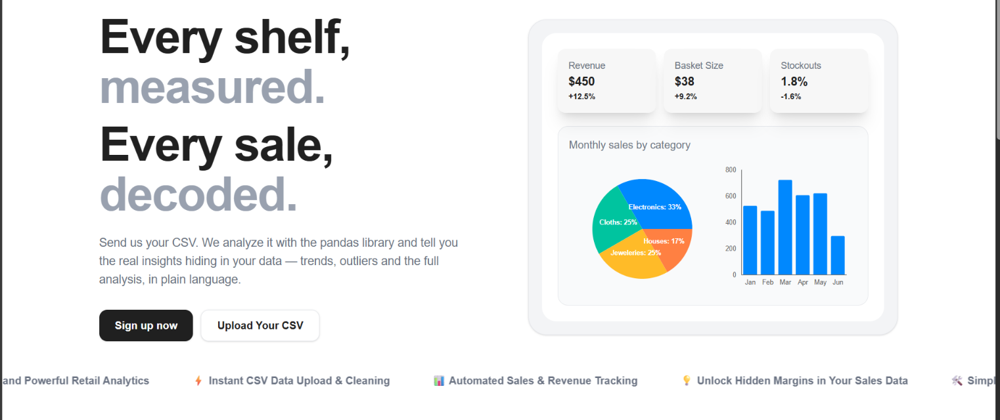

# RetailLens


**Live demo:** [RetailLens](https://retail-sass.netlify.app/)


RetailLens is a sales analytics dashboard for retail teams. Upload a sales CSV
to turn order-level data into clear performance metrics and visualizations. Teams can review revenue, products, categories, regions,
and customer segments in one place. An optional AI insights API can help
interpret results and identify practical next steps.

## Features

- Upload and validate sales CSV files, with row-level feedback for invalid data.
- View dashboard metrics and charts for revenue, units, orders, average order
  value, growth, profit, products, regions, categories, and customer segments.
- Filter and export upload summaries from the dashboard.
- Request optional OpenRouter-powered insights that compare an upload with
  recent analyses through the authenticated API.
- Create accounts and workspaces, invite workspace members, and use role-based
  access (Admin and Viewer).
- Reset account passwords by email.

## Technology

| Area | Technologies |
| --- | --- |
| Frontend | Next.js App Router, React, TypeScript, Tailwind CSS |
| Charts and UI state | Recharts, Zustand |
| Frontend API and validation | Axios, Zod |
| Backend API | Python, Flask, Flask-CORS |
| Database | MongoDB, accessed with PyMongo |
| Authentication | JWT access and refresh tokens |
| Email | Resend |
| AI insights | OpenRouter Chat Completions API |

## How it works

1. An Admin uploads a CSV from the web application.
2. The Flask API checks the file and required columns, validates each row, and
   reports invalid rows without discarding valid ones.
3. Valid sales records are saved to MongoDB. The backend calculates summary
   metrics and grouped totals, stores the summary, and returns it to the
   dashboard.
4. The frontend presents the results as KPI cards, charts, tables, and
   filterable upload details.
5. An authenticated client can request insights. The endpoint sends the
   selected upload's summary and up to five earlier summaries to OpenRouter.
   The resulting insights explain supported trends and include actionable
   recommendations.

## MongoDB data model

The backend connects to the database named by `MONGO_DB_NAME` using the
`MONGO_URI` connection string. MongoDB stores both account/workspace data and
sales analysis data. The main collections are:

| Collection | Purpose |
| --- | --- |
| `users` | Account details, password hashes, workspace membership, and roles |
| `csv_uploads` | Upload filename, processing status, row counts, and upload time |
| `sales_records` | Validated order-level records associated with a workspace and upload |
| `analysis_summaries` | Calculated metrics associated with a workspace and upload |
| `password_reset_tokens` | Hashed, expiring password-reset tokens |
| `password_reset_locks` | Temporary password-reset request cooldowns |

An upload is associated with a workspace through its `user_id` field, which
stores the workspace's organization ID. Every upload, record, and summary query
is scoped to that ID, so users can see data shared with their workspace without
exposing another workspace's data. MongoDB JSON Schema validators and indexes
are created or updated with the database initialization command below.

The analysis is calculated by the backend; MongoDB stores the source records
and computed summary, rather than relying on the AI provider to calculate
business metrics. Summary metrics include total revenue and units, order count,
average order value, monthly revenue trend and growth, revenue by category and
region, top products, and—when the CSV includes the relevant optional fields—
customer segments, top customers, profit, and profit margin.

## CSV format

Each upload must be a UTF-8 `.csv` file with these required columns:

```csv
order_id,order_date,product,category,region,units,revenue
ORD-1001,2026-01-05,Widget,Accessories,North,2,30.50
```

- `order_date` must use `YYYY-MM-DD` format.
- `units` must be a non-negative whole number.
- `revenue` must be a finite, non-negative number.
- Optional columns: `product_id`, `customer_id`, `customer_segment`,
  `unit_price`, `unit_cost`, and `profit`.
- If `profit` is omitted but `unit_cost` is provided, profit is calculated as
  `revenue - units × unit_cost`.

Invalid rows are skipped and included in the upload's row-error report. A file
with no valid sales rows is not saved as a completed analysis.

## AI insights with OpenRouter

AI insights are optional and are exposed through an authenticated backend API
endpoint. The backend first calculates the metrics itself,
then the authenticated insights endpoint sends aggregate summaries—not the
underlying sales records or customer identifiers—to the OpenRouter Chat
Completions API. It includes the selected completed upload and up to five
preceding completed uploads from the same workspace, ordered oldest to newest.

OpenRouter is instructed to return up to five distinct insights as JSON. Each
insight contains a `type`, `title`, evidence-based `description`, and actionable
`recommendation`. The prompt asks the model to distinguish observed facts from
possible explanations and not invent missing facts or targets. The API checks
the response shape before returning it. If OpenRouter is not configured, the
insights endpoint responds with `503`; provider or response errors are reported
as an upstream failure.

Configure `OPENROUTER_API_KEY` and, optionally, `OPENROUTER_MODEL` in the
backend environment. The default model is `openai/gpt-4o-mini`. Keep the key
server-side; it is not a frontend setting.

Request insights for a completed upload with a valid access token:

```http
POST /api/analysis/uploads/<upload_id>/insights
Authorization: Bearer <access_token>
```

## Local development

### Prerequisites

- Python and pip
- Node.js and npm
- A MongoDB database (MongoDB Atlas or a local MongoDB server)

### Configure the environment

From the repository root, create the backend environment file and set its
values:

```powershell
Copy-Item .env.example .env
```

At minimum, set a strong private `SECRET_KEY` (at least 32 characters) and a
working `MONGO_URI`. For MongoDB Atlas, make sure the database user and network
access rules permit the connection. Set `OPENROUTER_API_KEY` to enable AI
insights. Email password resets require a Resend API key and sender address.

Create the frontend environment file:

```powershell
Copy-Item views\.env.local.example views\.env.local
```

`NEXT_PUBLIC_BACKEND_URL` should point to the Flask server, normally
`http://localhost:5000`.

Never commit `.env` files or API keys.

### Install dependencies and initialize MongoDB

Run these commands from the repository root:

```powershell
python -m venv .venv
.\.venv\Scripts\Activate.ps1
python -m pip install -r requirements-dev.txt
flask --app app init-db
```

The initialization command creates or updates the MongoDB collections,
validators, and indexes. It is safe to run more than once.

### Start the application

In one terminal, from the repository root:

```powershell
flask --app app run --debug
```

In another terminal:

```powershell
Set-Location views
npm install
npm run dev
```

Open [http://localhost:3000](http://localhost:3000). The API runs at
[http://localhost:5000](http://localhost:5000); its `/health` endpoint checks
the MongoDB connection.

## API overview

All application API paths are relative to the backend origin.

| Method | Endpoint | Access | Purpose |
| --- | --- | --- | --- |
| `POST` | `/api/signup` | Public | Create a user and workspace |
| `POST` | `/api/login` | Public | Log in and receive access/refresh tokens |
| `GET` | `/api/me` | Authenticated | Get the current user's profile |
| `GET`, `POST` | `/api/members` | Admin | List workspace members or add a Viewer |
| `POST` | `/api/analysis/uploads` | Admin | Upload and analyze a CSV (`file` multipart field) |
| `GET` | `/api/analysis/uploads` | Authenticated | List recent workspace uploads |
| `GET` | `/api/analysis/uploads/<upload_id>` | Authenticated | Get an upload and its summary |
| `POST` | `/api/analysis/uploads/<upload_id>/insights` | Authenticated | Generate AI insights |
| `POST` | `/api/forgot_password` | Public | Request a password-reset email |
| `POST` | `/api/reset_password` | Public | Reset a password using its token |

The related password-reset implementation notes and end-to-end checklist are
in [docs/password_reset.md](./docs/password_reset.md).

## Tests and quality checks

Backend tests use an in-memory MongoDB replacement and mock external email
delivery:

```powershell
pytest -q
```

Frontend checks:

```powershell
npm --prefix views run lint
npm --prefix views run build
```

## Team

- Eng. Yara Daraghmeh — [GitHub](https://github.com/YaraDaraghmeh) · [LinkedIn](https://www.linkedin.com/in/yaradaraghmeh/)
- Valeriia — [GitHub](https://github.com/lerkooow) · [LinkedIn](https://www.linkedin.com/in/valeriia-akh/)
- Kenisa Tetemke — [GitHub](https://github.com/kenucoffi) · [LinkedIn](https://www.linkedin.com/in/kenisa-tetemke-135487339)
- Afnan Alzeiti — [GitHub](https://github.com/afnanfayez) · [LinkedIn](https://www.linkedin.com/in/afnan-alzeiti/)
- Haneen Hanounaa — [GitHub](https://github.com/haneenhanounaa) · [LinkedIn](https://www.linkedin.com/in/haneen-hanouna-a22a49414)
- Tunde Ademola Kujore — [LinkedIn](https://www.linkedin.com/in/tundeademolakujore/)
